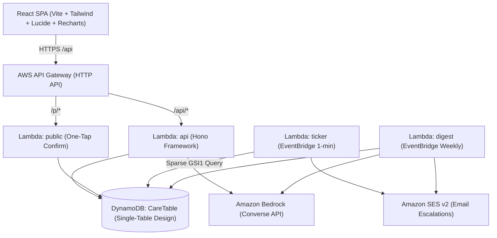
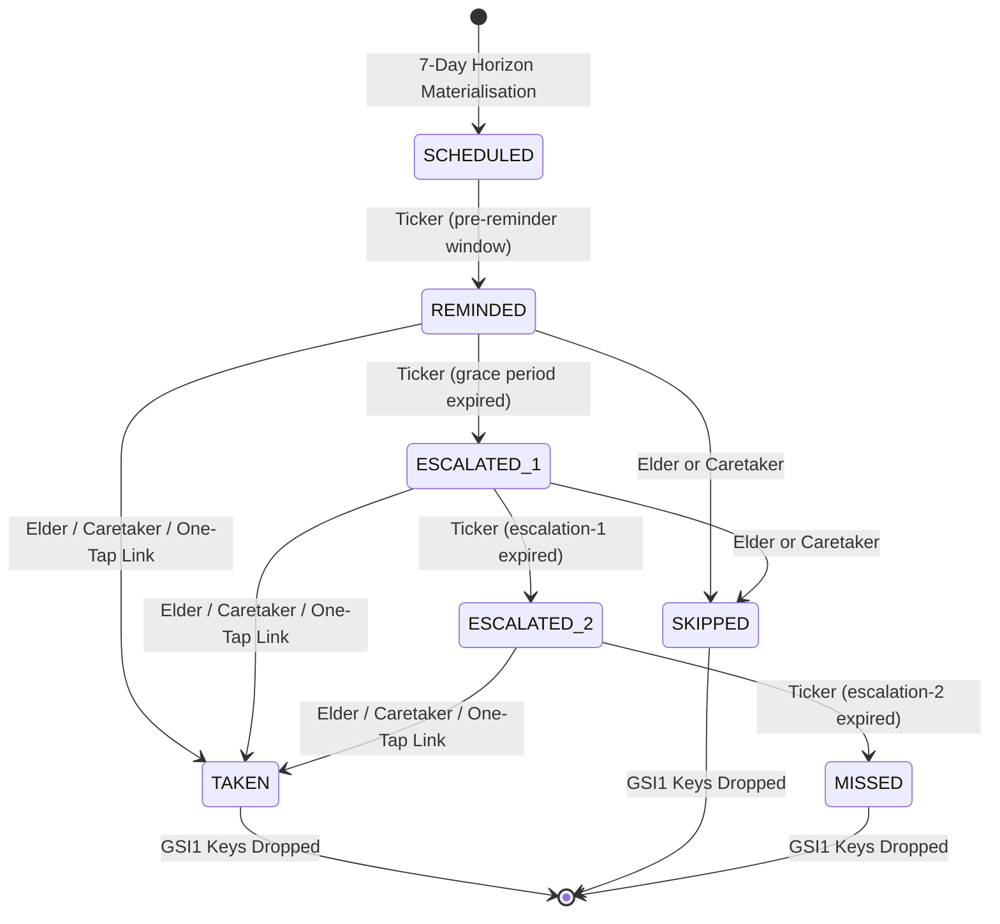

# CareCircle: Smart Elderly Care & Medication Management Platform

> An elder-centric healthcare & medication safety platform with multi-tiered escalation, one-tap email confirmations, and multimodal AI prescription scanning on AWS. Deployed in **ap-south-1 (Mumbai)**.

---

## 1. Overview & Key Innovations

Traditional reminder applications often fail the elderly because single smartphone alerts are easily missed or silenced, and solitary alarms leave family members in the dark.

CareCircle introduces an interconnected, multi-tiered safety model:

1. **Elder Accessibility at the Core:** High-contrast palette, 60px+ touch targets, uncluttered 3-tab layout, and browser **Speech Synthesis (Read Aloud)** with instant multilingual support (**English, Hindi, Marathi**).
2. **Dose Event Escalation State Machine:** Doses transition through:
   `SCHEDULED` ➔ `REMINDED` (elder) ➔ `ESCALATED_1` (caretakers) ➔ `ESCALATED_2` (family + caretakers) ➔ `MISSED`.
3. **One-Tap Confirm via Email:** Expiring signed token links in reminder emails let elders confirm taking medication in a single tap without needing to log in (GET landing page protects against email prefetch crawlers; mutation only occurs on POST).
4. **"Suggest, Then Approve" Safety Flow:** Family members can propose vitamins, schedule changes, or appointments, but the elder (or primary caretaker) explicitly approves them via simple Yes/No cards.
5. **Multimodal AI Prescription Scanner:** Uses **Amazon Bedrock Converse API** to extract schedule details from doctor notes and prescription photos directly into an editable review form with **confidence-aware verification**.
6. **Peace of Mind & Notification Center:** Live caretaker escalation stepper with countdown timers, glanceable Peace of Mind banner, and in-app Notification Center tracking every escalation attempt.

---

## 2. System Architecture



### Dose Escalation State Machine



---

## 3. Cloud Deployment Details

- **AWS Region:** `ap-south-1` (Mumbai)
- **Live HTTP API Gateway:** `https://odu8ihixga.execute-api.ap-south-1.amazonaws.com`
- **DynamoDB Single Table:** `carecircle-dev-table` (Pay-per-request, with sparse index `GSI1` and TTL)
- **Bedrock Region:** `us-east-1` (`us.amazon.nova-2-lite-v1:0` / Claude cross-region inference)
- **Frontend Hosting:** Vercel / Static Web SPA

---

## 4. DynamoDB Single Table Schema (`CareTable`)

| Entity | PK | SK | Key Attributes & Indexing |
| :--- | :--- | :--- | :--- |
| **Circle** | `C#{circleId}` | `META` | `name`, `elderName`, `timezone`, `settings` |
| **Member** | `C#{circleId}` | `M#{memberId}` | `name`, `email`, `role` (`ELDER`/`CARETAKER`/`FAMILY`), `passcodeHash` |
| **Login Lookup** | `U#{email}` | `LOGIN` | `circleId`, `memberId` (O(1) email login resolution) |
| **Invite** | `INV#{code}` | `META` | `circleId`, `role`, `expiresAt`, `usedAt`, `ttl` |
| **Medication** | `C#{circleId}` | `MED#{medId}` | `name`, `strength`, `form`, `times[]`, `pillCount`, `refillThreshold` |
| **Dose Event** | `C#{circleId}` | `D#{dueAt}#{medId}` | `medName`, `status`, `nextActionAt`, `GSI1PK="OPEN"`, `GSI1SK=nextActionAt` |
| **Appointment** | `C#{circleId}` | `A#{startsAt}#{apptId}` | `doctor`, `place`, `notes`, `stage`, `GSI1PK="OPEN"`, `GSI1SK=nextActionAt` |
| **Suggestion** | `C#{circleId}` | `S#{createdAt}#{id}` | `title`, `type`, `payload`, `status` (`PENDING`/`APPROVED`/`DECLINED`) |
| **Activity** | `C#{circleId}` | `L#{createdAt}#{id}` | `actorName`, `action`, `summary` |
| **Notification** | `C#{circleId}` | `NOTIF#{time}#{id}` | `to`, `stage`, `status`, `subject`, `error`, `ttl` |
| **Login Lockout** | `U#{email}` | `ATTEMPTS` | `count`, `ttl` (15-minute lockout after 5 failures) |

*Note: On terminal status transition (`TAKEN`, `SKIPPED`, `MISSED`, or appointment `DONE`), `GSI1PK` and `GSI1SK` are deleted so the sparse index only contains actionable open items.*

---

## 5. Demo Walkthrough & Accounts

See [docs/DEMO.md](docs/DEMO.md) for the end-to-end feature walkthrough and verification guide.

Run the seed script locally or use the in-app **"Reset Demo"** button on the caretaker dashboard:
```bash
npm run seed
```

### Pre-configured Demo Accounts
| Role | Name | Email | Passcode | Highlights |
| :--- | :--- | :--- | :--- | :--- |
| **Elder** | Grandmother Shanti | `shanti@demo.com` | `shanti123` | High-contrast UI, language toggle (EN/HI/MR), voice read-aloud, hero dose card. |
| **Caretaker (Admin)** | Son Rajesh | `rajesh@demo.com` | `rajesh123` | Peace of Mind banner, live escalation stepper, AI prescription scan, demo controls. |
| **Caretaker (Nurse)** | Nurse Anita | `anita@demo.com` | `anita123` | Clinical oversight, appointment scheduling, adherence reports. |
| **Family Member** | Daughter Priya | `priya@demo.com` | `priya123` | Family portal, adherence score, "Suggest, Then Approve" workflow. |

---

## 6. Honest Limitations & Architectural Trade-offs

1. **SES Sandbox Mode:**
   - Outbound emails via Amazon SES are currently running in AWS Sandbox mode. In sandbox mode, emails can only be delivered to verified recipient identities.
   - **Mitigation:** CareCircle records every escalation event in DynamoDB and displays a real-time audit trail in the caretaker **Notification Center** tab, so judges and evaluators can verify the entire notification chain even without verified email addresses.
2. **Cross-Region Bedrock Inference:**
   - Bedrock foundation models are queried using cross-region inference profiles (`us.amazon.nova-2-lite-v1:0` in `us-east-1`) from our Mumbai (`ap-south-1`) Lambda execution environment.
   - **Mitigation:** Network calls are guarded by a 10-second timeout, graceful 503 error handling, and a fallback manual entry button in the UI.
3. **Sparse GSI Scaling:**
   - The EventBridge ticker executes every 1 minute and queries `GSI1` (`OPEN` items). This scales efficiently for thousands of circles with zero full-table scans. For massive hyper-scale production (millions of users), an EventBridge Scheduler per-item schedule or SQS fan-out architecture would be preferred.
4. **Web Speech API Dependency:**
   - The Elder "Read Aloud" feature utilizes the browser's native `window.speechSynthesis` API. Audio voice fidelity and language accent vary based on the operating system and browser installed TTS voice engines.

---

## 7. Testing & Verification

```bash
# Run Vitest test suite (25 unit tests covering state machines, horizon extension, tokens, permissions)
cd backend && npm test

# Run live AWS integration tests against deployed stack in ap-south-1
npx tsx scripts/e2e/test-phase1.ts
npx tsx scripts/e2e/test-phase2.ts
npx tsx scripts/e2e/test-phase3.ts
npx tsx scripts/e2e/test-phase4-7.ts
```

---

## 8. Disclaimer
> **Disclaimer:** CareCircle is designed to assist families in coordinating medication routines and elder care. It is not a certified medical device and does not provide clinical medical advice. Always consult certified healthcare professionals.
