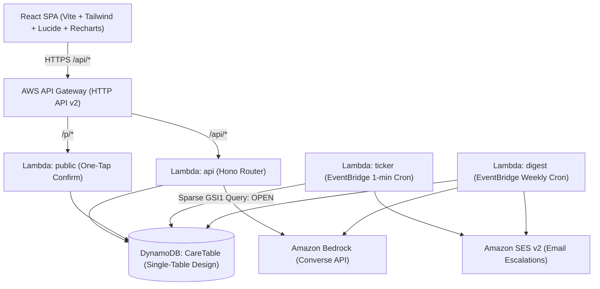
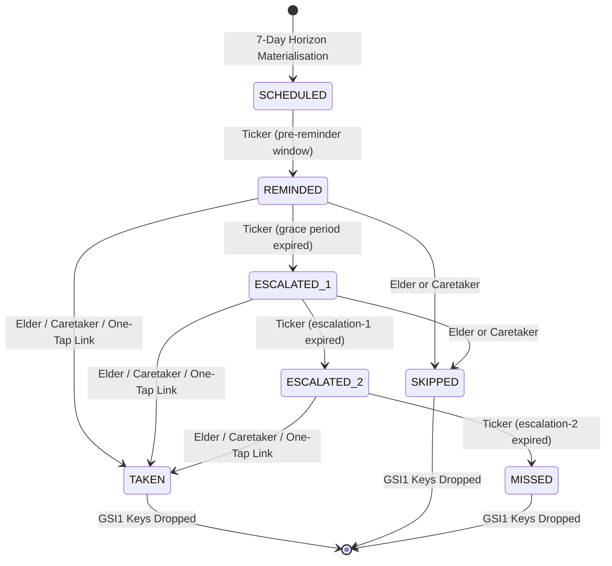

# CareCircle - Smart Elderly Care & Medication Safety Platform

<div align="center">


-FF9900?style=for-the-badge&logo=amazonaws&logoColor=white)


<br/>

> **"Bridging generations with proactive care, intelligent safety, and dignified independence."**

CareCircle is a modern, elder-centric healthcare and medication safety platform built for families across Bharat. Combining an accessible voice-enabled interface, autonomous multi-tiered escalation, one-tap email confirmations, and multimodal AI prescription scanning, CareCircle transforms solitary medication alarms into a shared, compassionate safety net.

</div>

---

## Overview

Traditional medication reminder apps fail the elderly. Single smartphone alerts are easily silenced or misunderstood, complex mobile UIs cause confusion, and solitary alarms leave caring family members anxious and in the dark when doses are missed.

**CareCircle** re-engineers this experience around the entire care circle (Elder, Primary Caretakers, and Extended Family):

- **For Elders:** An interface that treats dignity and simplicity as first-class constraints — massive high-contrast buttons, zero clutter, and native **multilingual speech synthesis** in English, Hindi, and Marathi.
- **For Caretakers & Nurses:** Real-time visibility through a glanceable **Peace of Mind banner**, live countdown escalation stepper, and full audit logs in the **Notification Center**.
- **For Family Members:** A cooperative **"Suggest, Then Approve"** workflow where family can propose vitamins, schedule modifications, or doctor appointments while keeping clinical control in the hands of the elder or primary caretaker.
- **For Everyone:** An automated **EventBridge & DynamoDB sparse-index engine** that proactively monitors open doses and escalates alerts before a missed dose turns into a medical emergency.

---

## Key Features

### Elder-Centric Accessibility & Multilingual Read-Aloud
- **Accessible Design:** High-contrast palette, uncluttered 3-tab layout, and generous 60px+ touch targets designed specifically for aging eyes and tremors.
- **Voice Read-Aloud:** Native browser Speech Synthesis (`window.speechSynthesis`) reads out active medications, dosages, instructions, and appointments aloud at the tap of a button.
- **Instant Multilingual Support:** Seamless toggling between **English (EN)**, **Hindi (HI)**, and **Marathi (MR)** across all labels, dialogues, and spoken audio.

### Multi-Tiered Dose Escalation State Machine
CareCircle replaces easily ignored single alerts with an autonomous time-window state machine running on Amazon EventBridge and AWS Lambda:
```
SCHEDULED ➔ REMINDED (Elder) ➔ ESCALATED_1 (Caretakers) ➔ ESCALATED_2 (Family + Caretakers) ➔ MISSED
```
- If an elder does not confirm a dose within the configurable grace window, CareCircle automatically notifies secondary caretakers and family members, escalating until confirmed or resolved.

### One-Tap Confirm via Email (Zero-Login Links)
- Every reminder email includes a cryptographically signed, single-use tokenized confirmation link.
- **Crawler & Prefetch Protection:** Safe GET landing pages ensure email antivirus scanners and link prefetchers do not inadvertently mark medications as taken. The mutation only executes on explicit user POST confirmation.
- Elders or family members can confirm medication intake in a single tap without remembering passwords or logging in.

### Multimodal AI Prescription Scanner (Amazon Bedrock)
- Powered by the **Amazon Bedrock Converse API** (`us.amazon.nova-2-lite-v1:0` via cross-region inference).
- Caretakers can snap photos of handwritten doctor prescriptions, clinic discharge slips, or medicine packaging.
- The AI extracts medication names, dosage strengths, intake frequencies, and meal instructions into an editable review form with **confidence-aware verification** and fallback manual entry.

### "Suggest, Then Approve" Family Collaboration
- Distant family members can propose new supplements, schedule changes, or appointments.
- Rather than uncoordinated changes, proposals enter a pending state and appear as glanceable **Yes/No approval cards** on the Elder and Caretaker dashboards.

### Peace of Mind Dashboard & Notification Center
- **Glanceable Banner:** Instant visual reassurance (green/amber/red) indicating whether all daily medications are safely on schedule.
- **Live Escalation Stepper:** Real-time countdown timers and visual phase indicators showing current escalation status with automated 10-second polling.
- **In-App Notification Center:** Transparent audit trail tracking every outbound notification, delivery state, stage transition, and error log.

### Weekly AI Health Digest
- Scheduled EventBridge cron aggregates 7-day adherence metrics and clinic visit logs.
- Bedrock synthesizes the data into warm, encouraging, and actionable weekly summaries emailed to family members.

---

## Technology Stack and Cloud Backend

| Layer | Technology | Purpose |
| :--- | :--- | :--- |
| **Frontend Framework** | React 19 + TypeScript 5.7 | Modern, componentized, type-safe web SPA |
| **Build & Tooling** | Vite 6.0 + Tailwind CSS 3.4 | Instant HMR, optimized production bundles (< 310 kB) |
| **Icons & Charts** | Lucide React + Recharts (Lazy Loaded) | Accessible iconography and interactive adherence charts |
| **Speech & Audio** | Web Speech API (`speechSynthesis`) | Browser-native multilingual text-to-speech without external API fees |
| **AWS Region** | `ap-south-1` (Mumbai) | Ultra-low latency for users across India |
| **Backend Framework** | Hono 4.x on Node.js 22 LTS | Ultra-lightweight, high-performance edge/serverless HTTP router |
| **Serverless Compute** | AWS Lambda | Pay-per-use execution for API, public confirm, ticker, and digest handlers |
| **Database** | Amazon DynamoDB (Single-Table Design) | High-performance single table with sparse index `GSI1` and TTL |
| **Event Orchestration** | Amazon EventBridge Scheduler | 1-minute ticker for open tasks, daily 7-day horizon extension, weekly digest |
| **AI / Multimodal LLM** | Amazon Bedrock (Converse API) | Multimodal vision & schedule extraction via `us.amazon.nova-2-lite-v1:0` |
| **Email Communications** | Amazon SES v2 | Templated transactional reminder and escalation emails |
| **Secrets & Config** | AWS Systems Manager (SSM) Parameter Store | SecureString encryption for JWT secrets and runtime configuration |
| **Infrastructure as Code** | AWS SAM (`template.yaml`) | Declarative CloudFormation infrastructure deployment |

---

## Architecture Overview

CareCircle follows a clean, modular architecture across frontend and backend:

```
catalyst/
├── backend/
│   ├── src/
│   │   ├── db/                # DynamoDB DocumentClient, keys, and entity repositories
│   │   ├── domain/            # Pure business logic (dose & appt state machines, schedule generator)
│   │   ├── handlers/          # Lambda handlers (API router, public confirm, ticker, digest)
│   │   ├── lib/               # Structured logger, auth middleware, zod validators, error models
│   │   ├── routes/            # REST endpoints (auth, circle, meds, doses, appts, suggestions)
│   │   └── services/          # Mailer, Bedrock AI integration, token signing, demo seed
│   └── test/                  # Hermetic Vitest unit & integration test suite (38 tests)
├── frontend/
│   ├── src/
│   │   ├── api/               # Typed API client and fetch wrappers
│   │   ├── context/           # Authentication and circle state providers
│   │   ├── features/
│   │   │   ├── caretaker/     # Caretaker modular tabs, modals, hooks, and escalation steppers
│   │   │   └── elder/         # Accessible elder interface, big cards, voice synthesis, i18n
│   │   ├── pages/             # Login, onboarding, and circle management
│   │   └── types.ts           # Centralized TypeScript domain contracts
│   └── test/                  # Vitest component & localization tests (3 tests)
├── docs/                      # Technical documentation, demo scripts, and architecture specs
├── scripts/
│   ├── e2e/                   # Live AWS integration verification scripts
│   └── seed.ts                # Standalone database population utility
└── template.yaml              # AWS SAM Infrastructure as Code definition
```

### System Architecture Diagram



### Dose Escalation State Machine



---

## DynamoDB Single-Table Schema (`CareTable`)

All application entities are consolidated into a single DynamoDB table utilizing a composite partition/sort key pattern with a sparse index (`GSI1`) for scalable, zero-scan operational queries.

| Entity | PK | SK | Key Attributes & Indexing |
| :--- | :--- | :--- | :--- |
| **Circle** | `C#{circleId}` | `META` | `name`, `elderName`, `timezone`, `settings` |
| **Member** | `C#{circleId}` | `M#{memberId}` | `name`, `email`, `role` (`ELDER`/`CARETAKER`/`FAMILY`), `passcodeHash` |
| **Login Lookup** | `U#{email}` | `LOGIN` | `circleId`, `memberId` (O(1) email login resolution) |
| **Invite** | `INV#{code}` | `META` | `circleId`, `role`, `expiresAt`, `usedAt`, `ttl` |
| **Medication** | `C#{circleId}` | `MED#{medId}` | `name`, `strength`, `form`, `times[]`, `pillCount`, `refillThreshold` |
| **Dose Event** | `C#{circleId}` | `D#{dueAt}#{medId}` | `medName`, `status`, `nextActionAt`, `GSI1PK="OPEN"`, `GSI1SK=nextActionAt` |
| **Appointment** | `C#{circleId}` | `A#{startsAt}#{apptId}` | `doctor`, `place`, `notes`, `stage`, `GSI1PK="OPEN"`, `GSI1SK=nextActionAt` |
| **Suggestion** | `C#{circleId}` | `S#{createdAt}#{id}` | `title`, `type`, `payload`, `status` (`PENDING`/`APPROVED`/`DECLINED`) |
| **Activity** | `C#{circleId}` | `L#{createdAt}#{id}` | `actorName`, `action`, `summary` |
| **Notification** | `C#{circleId}` | `NOTIF#{time}#{id}` | `to`, `stage`, `status`, `subject`, `error`, `ttl` |
| **Login Lockout** | `U#{email}` | `ATTEMPTS` | `count`, `ttl` (15-minute lockout after 5 consecutive failures) |

> **Sparse GSI1 Efficiency:** When an item reaches a terminal state (`TAKEN`, `SKIPPED`, `MISSED`, or appointment `DONE`), its `GSI1PK` and `GSI1SK` attributes are deleted. The 1-minute ticker queries *only* currently actionable open items, achieving $O(\text{open items})$ performance with zero full-table scans.

---

## Pre-configured Demo Accounts & Roles

See [docs/DEMO.md](docs/DEMO.md) for a step-by-step walkthrough of all persona workflows.

| Role | Name | Email | Passcode | Key Capabilities & Highlights |
| :--- | :--- | :--- | :--- | :--- |
| **Elder** | Grandmother Shanti | `shanti@demo.com` | `shanti123` | High-contrast UI, language toggle (EN/HI/MR), voice read-aloud, hero dose card. |
| **Caretaker (Admin)** | Son Rajesh | `rajesh@demo.com` | `rajesh123` | Peace of Mind banner, live escalation stepper, AI prescription scan, demo reset controls. |
| **Caretaker (Nurse)** | Nurse Anita | `anita@demo.com` | `anita123` | Clinical oversight, appointment scheduling, adherence history, medication administration. |
| **Family Member** | Daughter Priya | `priya@demo.com` | `priya123` | Family portal, adherence score, "Suggest, Then Approve" proposal flow. |

---

## Getting Started

### Prerequisites
- **Node.js**: `>= 22.0.0` (LTS)
- **npm**: `>= 10.0.0`
- **AWS CLI**: Configured with credentials in `ap-south-1`
- **AWS SAM CLI**: `>= 1.100.0` (for cloud packaging and deployment)

### 1. Installation

```bash
# Clone the repository
git clone https://github.com/aryan54-rgb/CareCircle.git
cd CareCircle

# Install root, backend, and frontend dependencies
npm install
npm install --prefix backend
npm install --prefix frontend
```

### 2. Local Development

Run the frontend locally against mock or live API:
```bash
# Start frontend dev server with Vite
cd frontend
npm run dev
# Accessible at http://localhost:5173
```

### 3. Production Build

```bash
# Build frontend with Vite & TypeScript type checking
npm run build --prefix frontend

# Bundle outputs:
# - dist/assets/index.js           ~309 kB (Core application chunk)
# - dist/assets/AdherenceChart.js  ~369 kB (Lazy-loaded Recharts chunk)
```

---

## Automated Testing & Quality Verification

CareCircle includes an automated test suite verifying state machines, permission boundaries, token security, HTML escaping, and UI components:

```bash
# Run backend Vitest test suite (38 unit & integration tests)
cd backend && npm test

# Run frontend Vitest test suite (3 component & localization tests)
cd frontend && npm test

# Run all test suites across the repository (41 total tests)
npm test

# Run strict TypeScript compilation check (0 errors)
npx tsc --noEmit --project backend/tsconfig.json
npx tsc --noEmit --project frontend/tsconfig.app.json

# Run Oxlint static analysis (0 warnings, 0 errors across 36 files)
npx oxlint frontend/
```

### End-to-End Cloud Verification Scripts
For testing against live deployed AWS infrastructure in `ap-south-1`:
```bash
npx tsx scripts/e2e/test-phase1.ts    # Auth, invites, and token validation
npx tsx scripts/e2e/test-phase2.ts    # Single-table DynamoDB CRUD & sparse GSI1
npx tsx scripts/e2e/test-phase3.ts    # Escalation state machine & SES delivery
npx tsx scripts/e2e/test-phase4-7.ts  # Bedrock AI scanning & full integration
```

---

## Architectural Trade-offs & Limitations

1. **SES Sandbox Mode:**
   - Outbound emails via Amazon SES operate in AWS Sandbox mode, which restricts delivery to verified recipient identities.
   - *Mitigation:* CareCircle records every escalation event in DynamoDB and displays a real-time audit trail in the **Notification Center** tab, allowing full verification of the notification pipeline even without verified recipient inboxes.
2. **Cross-Region Bedrock Inference:**
   - Amazon Bedrock models are invoked via cross-region inference profiles (`us.amazon.nova-2-lite-v1:0` in `us-east-1`) from Mumbai (`ap-south-1`) Lambda execution environments.
   - *Mitigation:* Network invocations are guarded by a 10-second timeout, structured 503 error handling, and an immediate fallback manual entry interface in the UI.
3. **Sparse GSI Scaling:**
   - The EventBridge ticker executes every 1 minute and queries `GSI1` (`OPEN` items). This scales efficiently for thousands of circles without full-table scans. For hyper-scale production (millions of concurrent users), an EventBridge Scheduler per-item schedule or SQS fan-out architecture would be preferred.
4. **Web Speech API Dependency:**
   - The Elder "Read Aloud" feature utilizes the browser's native `window.speechSynthesis` API. Voice fidelity, clarity, and language accents vary based on the operating system and installed browser TTS engines.

---

## Contributing and Community

We welcome contributions to help improve elderly healthcare technology. Please review:
- [docs/DEMO.md](docs/DEMO.md) for full feature testing guidelines
- [docs/HANDOVER.md](docs/HANDOVER.md) for architectural handover context
- [docs/SPEC.md](docs/SPEC.md) for engineering specifications

---

## Disclaimer

> **Disclaimer:** CareCircle is designed to assist families in coordinating medication routines and elder care. It is not a certified medical device and does not provide clinical medical advice. Always consult certified healthcare professionals for medical guidance.

---

## License

Distributed under the MIT License. See `LICENSE` for details.

<div align="center">
  <i>CareCircle: Proactive healthcare, loving oversight, and dignified independence for our elders.</i>
</div>
